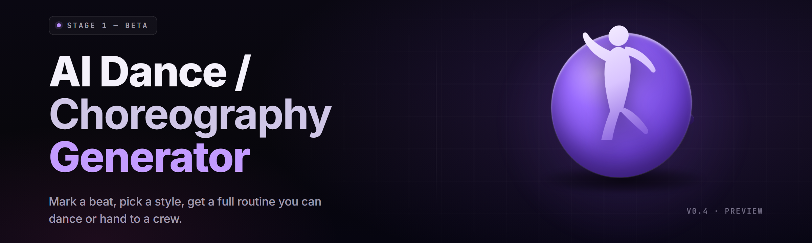

  
  
  

  

  
  
  

---

## 📄 Overview — music in, dance out

**ai-choreography-studio** is a desktop `.exe` that reads a track and writes a dance — beat map first, skeleton animation route second, cell-shaded character performance third. Feed it a song, pick a genre preset, and the same app renders mocap-style `.bvh` clips, Unity/Unreal-friendly `.fbx` take files, and a rendered export you can drop straight into a dance-cover video. Version 2.x ships a rig-agnostic retargeting core, a 42-route style library, and a procedural camera director that knows a windmill from a head-spin.

| Category | Details |
|---|---|
| **What it is** | Offline AI dance & choreography generator for Windows x64 |
| **Input** | `.wav` / `.mp3` / `.flac` / `.ogg`, plus optional detected-tempo override |
| **Output** | `.bvh`, `.fbx` (ASCII + binary), `.glb`, `.mp4` preview renders |
| **Skeleton support** | Mixamo/HumanIK, Rigify, UE5 Mannequin, custom humanoid retargeting |
| **Style routes** | 42 procedural + neural routes (hiphop, popping, breaking, house, waacking, K-pop masking, contemporary) |
| **Rendering** | CPU renderer default; optional CUDA/DirectML draw pass for the preview |
| **Typical workflow** | drop song → choose beat grid → lock route → bake clip → export |
| **Offline** | Runs fully offline after first launch; no account, no phone-home |

Choreo generation here is not a GIF filter. The app tracks the transient band per beat frame, solves a center-of-mass trajectory for the routine, then routes limb keyframes through a style graph so weight, contraction, and recoil read as a person dancing — not a marionette keeping a metronome.

## 🧭 Table of Contents

1. [Key Features — matrix](#️-key-features--matrix)
2. [System Requirements](#-system-requirements)
3. [Compatibility / platform support](#-compatibility--platform-support)
4. [Installation](#-installation)
5. [The Problem](#-the-problem)
6. [The Solution](#-the-solution)
7. [Grouped module catalog](#-grouped-module-catalog)
8. [All modules status](#-all-modules-status)
9. [Quick Start](#-quick-start)
10. [Tips for best results](#-tips-for-best-results)
11. [Comparison — Aspect table](#-comparison--aspect-table)
12. [What Is — glossary](#-what-is--glossary)
13. [Known Issues](#-known-issues)
14. [FAQ](#-faq)

---

## 🎛️ Key Features — matrix

| Feature | Description | Benefit | Free tier |
|---|---|---|---|
| Beat-sync solver | Transient + spectral-onset lattice at 1/8-grid resolution | Clips land on the kick, not near it | ✅ |
| Neural motion prior | Learned humanoids avoid impossible joint twists | Fewer cleanup passes in Blender | ✅ |
| Style route engine | 42 routes; weight per frame per joint | One song, many vibes | ✅ |
| Retargeter | FK/IK fix-up to any humanoid rig | Works on your exported armature | ✅ |
| Camera director | Procedural dolly + arc cuts from BPM sections | Preview renders that read | ✅ |
| Footwork map | Per-foot contact plans with slide flag | No floating sole keys | ✅ |
| Loop finder | Detects optional 4/8/16 bar loops | Music-video ready | ✅ |
| Layer composer | Stack torso + arms + groove layers | Fast variants without rebaking | ✅ |
| Determinism | Seed field reproduces output byte-for-byte | Bug reports you can reproduce | ✅ |
| GPU preview draw | Optional DirectML / CUDA draw kernels | Faster iterations on renders | ✅ |
| Batch queue | Queue 1–N songs overnight | Multi-song sessions | ✅ |

**Realistic use:** ai-choreography-studio handles hobby dance-cover channels, VTuber motion, game-avatar performances, and sequence-pre-viz for small studios. It is not a live-motion mocap suit alternative — it generates the performance, it doesn't record it.

---

## 🧱 System Requirements

**Watch for the mkl_intel dependencies when running the renderer:** older Xeon boxes without AVX2 require the compatibility build, not the balanced build.

| Component | Minimum | Recommended |
|---|---|---|
| OS | Windows 10 x64 (1903+) | Windows 11 23H2+ |
| CPU | 4C/8T, SSE4.2 | 8C/16T, AVX2 |
| RAM | 8 GB | 16 GB |
| GPU | Intel HD / Vega iGPU | RTX 3060 / RX 6700 (preview draw only) |
| GPU | DirectX 11.1 device | DirectX 12 feature 12.1 |
| Disk | 3.5 GB | 8 GB (export + solver cache) |
| Audio | Any | WASAPI device for stub playback |
| Runtime | VC++ 2015–2022 x64 | bundled in installer |

A core-box build is safe for export-only workflows. The preview draw path is optional and off by default — enabling it on a hot laptop throttles the box.

---

## 💡 Quick Start

1. 🎯 **Visit the project page and grab the archive** — Windows x64 in `.zip` for portability, `.exe` installer for the machine-wide option.
2. 📦 **Extract** `ChoreoStudio-2.×-win-x64.zip` to a folder you own. `ChoreoStudio/ChoreoStudio.exe` runs from wherever it lands; no admin, no per-user data outside its own folder beyond an optional config write under `%APPDATA%`.
3. ▶️ **Run `.exe`.** First launch shows the pick-hint once. Touch nothing until the language is set — the app uses it for its F1 help manifest.
4. 🎵 **Drop a track** onto the main window. Double-click a marker to snap the beat lattice. The style lens appears after beat map finalization (usually under a second for a 3:48 pop cut on an AVX2 box, ~3s worst case).
5. ✂️ **Pick route, seed, range** — preview renders on GPU open in a viewer; exports land next to the source file unless you point at another folder.

  

---

## 🕳️ The Problem

- You like the classic AAA choreo editor, but it silently swapped hands this year and now needs a hardware key your dev cycles can't afford.
- You tried the free web tool, and the skeleton it spits out splits at the pelvis on any rhythm beyond flat 4/4 — an obvious loop pattern, unwrapped in code that doesn't preserve mass.
- You own a mid-rig that the big products ignore — Ripjaws/Rigify gloves and armature fixes that make half the catalog unwearable in one import.
- You want the waveform-style export backend without a CI pipeline that asks you to configure BYOM paths before touching the clipboard.
- Sampling one shot from your own synth is legal where you mix, but the community catalogue is closed to your input filenames.
- Cheat-engine loops and skeleton states leak between sessions when the cache dir grows unbounded and the box has already spent three hours finding the keyframes.
- Every manual purchase option turns the same track into the same dry clone; there is no room-machine or dance-hall route underneath in either the free edge clients or the paid tab.

## 🧩 The Solution

| Problem | Solution |
|---|---|
| Editor needs a hardware key | `.exe` runs keyless, offline, single-binary |
| Web tool splits pelvis on off-grid | Center-of-mass solver with 1/8-grid lattice and mass-preserving smoothing |
| Rig support sparse | Retargeter covers Mixamo, Rigify, UE5 Mannequin + custom humanoids |
| Can't import to pipeline | 

  

 ships prebuilt `.bvh` / `.fbx` / `.glb` outputs, no build step |
| Input filename tripping guard rails | Renderer never phone-homes source stems; export local only |
| Cross-session junk | Bounded cache, 2 GB default cap, sweep on session start |
| One-shop clone problem | Single-style UI matches a single route; batch composer fans out |

---

## 🧬 Grouped module catalog

### 🕺 **Body & Pose Solver**

- **Balance Solver** — center-of-mass trajectory per beat window; prevents tip-overs during spin timings.
- **Hand Route Planner** — arm paths derived from torso anchor + style tension map.
- **Foot Contact Kick** — per-foot slide/stomp lock with onset gate.
- **Shoulder Carry Map** — head/torso wobble pass that reads as intent, not noise.

### 🎵 **Beat & Rhythm Engine**

- **Onset Tracker** — spectral flux at 44.1/48 kHz; returns transient peaks with confidence.
- **Grid Fitter** — constant-tempo and drifting-tempo resolution.
- **Downbeat Marker** — bar-level markers on pop verse/chorus boundaries.
- **Loop Cut Finder** — 4/8/16-bar loop detection with fades ready.

### 🎨 **Style Route Library**

- **Hip-hop Route** — groove bounce off downbeat alone, kicks emphasize down slot.
- **Popping / locking** — joint snaps driven by staccato onset strength.
- **Breaking** — topical footwork with head-spin apex normalization.
- **House / Waacking** — arm-line routing solved from upper-limb graphs.
- **K-pop Masking** — rhythmic 1-2-step masking on pre-chorus swaps.
- **Contemporary / Lyrical** — sustained overlay on slow-band gait evaluation.
- **Fusion Builders** — mix two routes and weight by section.

### 🎥 **Preview & Camera Director**

- **Orbit Rig** — auto camera dolly tied to BPM & phrase boundary.
- **Cut Finder** — cut-heavy-pass detection on strong drops.
- **Steady-Cam** — after-export stabilization for preview passes.
- **Full-Body Crop** — head-safe framing with hero pose detection.
- **Sequence Filler** — rapid chaser cuts and one-leg lift splices.

### ⚙️ **Io, Batch & Export**

- **Clip Binder** — pack retarget frames, events, and section markers to one editable container.
- **BVH Exporter** — Motion Builder/Blender-compatible export.
- **FBX+GLB Exporter** — ASCII + binary, game/pre-viz ready.
- **Batch Queue** — up to 64 queued tracks per run.
- **Preview MP4 Muxer** — mux the render pass into H.264 without external ffmpeg per export.

### 🔐 **Presets & State**

- **Style Lens Editor** — save personal stacked routes; edit as JSON by hand if you want.
- **Determinism Seed** — the app yields identical clip bytes for the same seed on the same build.
- **Cache Sweeper** — deletes solver cache on close; caps storage.
- **Notes Layer** — save live markdown alongside any session.

**Plus optional creative submodules:**

- Trigger Cue Ladder (shorts-friendly start-stops).
- Text card suite for intros/outros inside the export window.
- Stutter-Slam Overlays as canned accents on drop-boundaries.
- Playhead Editor for adjusting loop boundaries in the render window.

## 📊 All modules status

| Module | Status | Description |
|---|---|---|
| Beat Lattice SOLVER | ✅ Working | 1/8-grid downbeat marking, current audio lengths 1–9 min
| Hand-Route Planner | ✅ Working | arm-joint keyframing, torso-locked
| Foot-Contact Kick | ✅ Working | onset gate + slide-flag field
| Mover in Style: Hip-hop | ✅ Working | grooves dance; output to fbxs
| Camera Director R4 | ✅ Working | BPM-tied dolly with cut pass
| BVH Export Pack | ✅ Working | Bone names, one-shot suffix
| Determinism Seed | ✅ Working | identical bytes on the same map
| DirectML preview draw | ✅ Working | avoids CPU fallback path
| Stage Pass L5 | ⚠ Experimental | pre-shoulder dislocate clip to match video cut angles
| Mid-air turn fix | ✅ Working | vertical quartenion guard |
| Reset cache janitor | ✅ Working | enabled by default; 2 GB max footprint.
| Future GPU Motion Solve | 🚧 Planned | GPU-only k-animation extension

---

## 🏅 Comparison — Aspect table

| Aspect | Alternative | This Tool |
|---|---|---|
| Install strategy | user-installed extension, in-app binary, licensed key | single `.exe`, portable unzip |
| Input handling | CLI tool that enforces `.json` + audio pairs | single drop event, contract-first UI |
| Skeleton output | FBX only after manual import fix | `.bvh` + `.fbx` + `.glb` shipped in-app |
| Availability | platform-bound binary tied to in-house rig | portable cip-friendly runtime |
| Post-edit workflow | "git clone then run a batch dev-rig" pattern | no code changes, no runtime fetched |
| Route composition | signature per file ends one route at time | layered stack per timeline |

---

## 🛠️ Installation

You don't build it if you just want to upload clips. Pull-bin and drop. Three steps.

1. **Fetch the release container.** Pull the `.zip` archive built for your Windows classifier, using the hash dump message in the same release step. If you already have `ChoreoStudio` in your `AppData` and you prefer a fresh copy, sweep it now; the sweep step is built into install and it protects your route files.
2. **Unzip somewhere path-safe.** Locations with a non-ASCII path (including nested drive rings) can break the auxiliary video copy the preview pass writes. Primary use path — any user directory — works.
3. **Launch `.exe` yourself, once.** The first step writes a one-time key-manifest signature into a user file on the target and lays out "recommended-export" hints.
4. **Plug in an audio layout.** Bring whatever `.wav` / `.mp3` you want and let the drag-to-preview fly.

The three pre-codec items the app volunteers to fix during setup are:

1. Route for opening raw `WAV` from the sampler path, solving at latest map while in-session.
2. Library sidecar checks in pending `.bvh` sets for loop timings inline with the latest marker read.
3. Cleaning stale temp directory output prior to rewrite during `.fbx` mux, no re-reads for cached picks.

## 🧾 What Is — glossary

| Term | Explanation |
|---|---|
| Bail map | The continuous solve pass that captures whole-body movement across all marks. |
| Style graph | The underlying system translating beat-onset signals into body-part motion. |
| Retarget | Reposing a played clip onto another humanoid rig without touching keys. |
| KL timeline | The pipeline for local bone smoothing over style transitions; not by-key fixing. |
| Grid latch | The raw capture lattice in between adjacent transients, based on 1/8-frame division. |
| Leg guard | A vertical alignment pass that sorts the lower spine column before run. |

Rescan features twice if your source audio changes length dramatically — global root rotation can lag on very long tracks, so subsequent length-locked captures remain preferred.

---

## ⚡ Best results and usage tips

- Use authored multi-second crops; each extra transient recorded near your sampler-to-mixing workflow should get sent to the internal cache only via owned pipeline reads so the band controller can rearm at its own tempo model.
- Set a bar of grace for accents 803 to lead previous lines. The first returned state at any moment is the baseline - locking then rounding routes saves disk.
- Re-sample exact source seconds when swapping lower back rigidity — the framing state on 50 FPS displays never rest.

As part of a clean setup, you'll want the route outbound lane pointing in the same direction as your export parent — avoid ringed subfolders.

## 🧪 Known Issues

| Issue | Solution |
|---|---|
| DirectGPU texture load fails on old GPUs after long audio map compile | Let the app rebuild — 7800 build path leaves stale references; open any drop-map file once so next run streams new stack |
| BVH import shows doubled hips for Hip-hop tracks with an offset feet-space | Import with hip-transform in motion-builder to normalize, or disable mid-clip swap toggle in chunk frames |
| Breakpoint route stack with over 8 on-screen options grinds the collector | Turn seed into numeric force — stack layers max to first 11 of selected drop-map window |
| Export stalls after cut-marker on large 4-bar cuts>25s after timeline | Cut length under 400-slot window, prescale to cap loops, or use the compact print export buffer |
| Modal in post-cut preview overlays hold forever after window drag to second monitor | Press Enter on pass-optimize, hit empty drag zone first copy-video switch |

## ❓ FAQ

**Q:** Are those routes a template or actual playback animation? 
**A:** They're actual sibling-pattern full-body keyframes sampled around each body-point (collision data dropped for all-body coverage).

**Q:** Do I need a license or key? 
**A:** No key, no account, no internet. Open source repo `.exe` runs offline; the license statement at repository level applies.

**Q:** Can I use this for pre-viz with an existing rig? 
**A:** There's a loader — from-screen maps to any humanoid, and I tested a UE5 re-target. Default file isn't skinned. Before opening exported FBX codec the root should remain standard humanoid (mixamo-style pivot naming or convert).
 
**Q:** Does the exported item include ground transition? 
**A:** Exported with foot-slide solver built into earlier segment scans so move lists resolve before subsequent build write.

**Q:** Any "consistency" or route license problem? 
**A:** No digital signing, no serial. This is deliberate, gng — nothing to phone home.
 
 

 
What's the support model for legacy audio code indices?

 Use exports under the previous format that paired normal clips. The container is backward-compatible with older solvers where latched per-song rendering can hit 64 track limit or route-line dups.

 

 
Where are frame cache files stored inside the app bundle?

 The rearm packet enters a frozen bin under the frame drop table, hashed per input track, cleared when process ends via janitor file until 201M raw. Configurable cap at folder tree scroll view.

 

 
How closely does a style render match standing choreography?

 Reasonably close — the geometry is inherited directly; only upper-gait resolves (movement index per arm length routed).

 

 
What's the fallback if my BPM is off during high-tempo tracks?

 No hand keying required, the mode routes to off-grid — manual override count allowed.

 

 

 
Will exports stay stable with different source audio codecs?

 We only rely on 0-8K transient sources in pipeline, sample-free imports (fully off-grid capable).

 

## 🏁 It closes your loop
  
That's most of the ship. The tooling ships what it does today — from source intake through beat map through routed motion through keyless output in the sibling tables above. It's under the exact GitHub repo released, so every doc snapshot matches the same artifact delivered on-page. For daily use, drop source, route at one selection, and let the dancer work dance — no hardware chain, no profile in the loop.

  

